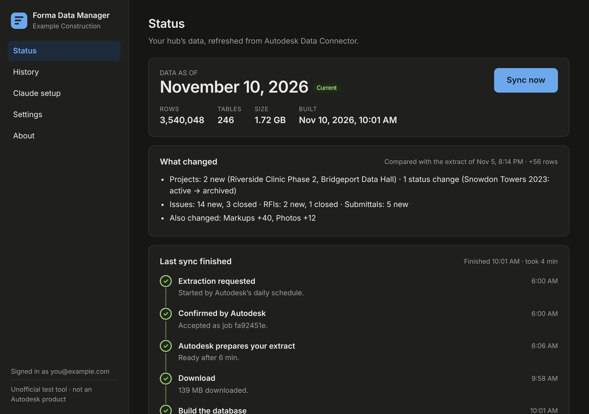

<p align="center"></p>

<h1 align="center">Forma Data for Claude</h1>

<p align="center">
Ask Claude about your Autodesk Forma (ACC / BIM 360) hub in plain language, and get answers and dashboards built on clean, checked data.<br>
A Windows app pulls your hub's data from Data Connector every day, builds a fast local database, and connects it to Claude Desktop through MCP.
</p>

> [!IMPORTANT]
> **Unofficial test code, provided as is.** This is a personal community project. It is **not** an Autodesk product and is not endorsed, supported or warranted by Autodesk, Inc. or Anthropic. **Autodesk, Anthropic and the authors have no liability** for its use. Read the [DISCLAIMER](DISCLAIMER.md) before installing.

<p align="center"></p>

---

## What it does

```
 Autodesk Forma hub                      Your Windows PC                                      Claude Desktop
┌──────────────────┐  Data Connector  ┌───────────────────────────────────────────────┐  MCP   ┌──────────────┐
│ projects, issues │  API (daily or   │ Forma Data Manager  ──►  forma-data engine    │ stdio  │ "Which RFIs  │
│ RFIs, cost, ...  │ ───────────────► │ (sign-in, schedule,      build → SQLite       │ ◄────► │  are overdue │
└──────────────────┘   Sync now)      │  download)               serve → 8 MCP tools  │        │  on ...?"    │
                                      └───────────────────────────────────────────────┘        └──────────────┘
```

1. **Pulls data from Autodesk.** You sign in once with your Autodesk account. Every day at a time you choose, Autodesk's Data Connector prepares a fresh extract of the whole hub on its servers (the app sets up and looks after that daily schedule for you), and the app downloads it. **Sync now** starts an extra extraction whenever you want one. No manual ZIP files.
2. **Builds a database you can trust.** The engine turns the extract into a SQLite database using Autodesk's own published schema. It adds cleaned-up views (`v_rfis`, `v_change_order_chains`, …) and a precomputed per-project rollup, checks the result, and only then swaps it in. A bad extract never replaces good data.
3. **Connects Claude.** The installer's setup wizard registers the `forma-data` MCP server with Claude Desktop. The dashboard guide (house style plus data rules) is built into the server, so there's nothing else to install. Claude can then answer questions and build dashboards in seconds.

## Built for accurate answers

| Problem with typical setups | What this does |
|---|---|
| Types guessed from a sample, so zeros silently became NULL, and `"007"`-style codes lost leading zeros | Uses the official Data Connector schema; zeros stay zeros; codes stay text; anything odd is kept and counted, never dropped |
| Views broke when a table had no `deleted_at` (RFIs, submittals) | Views are built defensively and checked at build time; every view's row count equals its base table's active rows |
| JOINs to user/type tables duplicated rows (one duplicated user = double-counted issues) | Every name lookup is a scalar lookup that can't multiply rows |
| "Open" means something different in every module | `status_group` (`draft` / `open` / `closed` / `void`) in every view |
| Overdue measured against today on a weeks-old snapshot | `is_overdue`, `days_overdue`, `age_days` are measured against the extraction date |
| Change orders summed across PCO/RFQ/RCO/OCO/SCO legs (up to 5× overcount) | `v_change_order_chains`: one row per real change, exposure = largest proposed amount |
| Ambiguous project names merged into one "project" | `forma_project_summary` returns the candidates and asks |
| Opening tool calls returned ~110K characters, too much for the model | Compact outputs (≈9K for the overview), real column values via `forma_describe`, 30 s query timeout |

Details: [docs/data-model.md](docs/data-model.md).

## Requirements

- Windows 10 or 11 (x64) and [Claude Desktop](https://claude.ai/download). Claude Code also works.
- An Autodesk Forma (ACC) or BIM 360 hub, and a user with **Executive Overview** access to it, because Data Connector needs it to extract the whole hub. A hub admin grants it in Hub Admin (being a hub admin doesn't include it automatically).
- A free **APS app** (client ID) that a hub admin adds under **Hub Admin → Custom Integrations**. This takes about 5 minutes: see [docs/aps-app-setup.md](docs/aps-app-setup.md).

## Install

1. Download `Forma-Data-Manager-Setup-<version>.exe` from the [latest release](../../releases/latest). The installer isn't code-signed, so SmartScreen may warn you: choose **More info → Run anyway**. Compare the file against `SHA256SUMS.txt` if you like.
2. Accept the license and disclaimer, then install. No admin rights needed.
3. The setup wizard opens: disclaimer → APS client ID → **Sign in with Autodesk** → pick your hub → data folder → daily schedule (Autodesk prepares it, recommended, or this computer starts it) → **Set up Claude Desktop** → first sync.
4. Fully quit and reopen Claude Desktop. Ask something like *"Using forma-data, which active projects have the most overdue RFIs?"*

More detail: [docs/install.md](docs/install.md).

## What you can ask

- "Give me a risk dashboard for all active production projects: overdue RFIs, open change-order exposure, forecast overruns."
- "On *Riverside Hospital*, which submittals are overdue and who has the ball?"
- "Which change orders are stuck, executed on one leg but still proposed on another?"
- "Show asset commissioning progress by category for the data center projects."
- "Where is retention stored?" (Claude can search Autodesk's own column descriptions.)

## MCP tools

| Tool | Use it for |
|---|---|
| `forma_overview` | Data freshness, what changed since the previous extract, project counts, modules, views and conventions. Called once per conversation |
| `forma_find_projects` | Which/how many projects (exact counts, demo/template flags) |
| `forma_project_summary` | Everything about one project; returns candidates if the name is ambiguous |
| `forma_sql` | Read-only SQL on the views, `project_rollup` and raw tables |
| `forma_describe` | Columns, Autodesk's descriptions and real values (e.g. every status) before filtering |
| `forma_catalog` | Where data lives; search table/column names and descriptions |
| `forma_search` | Full-text search across issues, RFIs, submittals, meetings, forms, cost and more |
| `forma_dashboard_guide` | The dashboard house style and data rules; Claude loads it on its own before building a dashboard |

Plus the `forma_dashboard` prompt. Reference: [docs/mcp-tools.md](docs/mcp-tools.md).

Prefer it as a skill? The repository is also a **Claude plugin marketplace**: in Claude, go to **Customize → Plugins → Add → Add marketplace → Add from a repository**, enter `arqfernandolima-rgb/forma-data-manager`, and install **forma-data**. In Claude Code: `/plugin install forma-data --marketplace arqfernandolima-rgb/forma-data-manager`. It's optional, and it stays updated from this repo. See [docs/claude-setup.md](docs/claude-setup.md#the-dashboard-guide).

## Privacy and security

- Your Autodesk sign-in uses OAuth with PKCE (no client secret) through **your own** APS app. Tokens are encrypted with Windows DPAPI for your Windows account.
- The data stays on your computer, in the folder you choose. Nothing is sent to the authors.
- The app's only changes in your hub are Data Connector requests: one per sync it starts (it cleans up its own old ones) and one daily schedule it maintains. Other hub admins can see them. Details: [SECURITY.md](SECURITY.md#what-it-changes-in-your-hub).
- When you ask Claude a question, query **results** go to Claude as part of your conversation, under your Claude account's terms. Decide whether that's appropriate for your data.
- The MCP server is read-only (SQLite opened read-only, `query_only` on, single SELECT/WITH statements).

More: [SECURITY.md](SECURITY.md).

## Limitations

- Snapshot data: it's as fresh as the last extract (Data Connector runs take minutes to hours on Autodesk's side). Claude is told to state "Data as of …" in its answers.
- Data Connector allows **24 extraction jobs per rolling 24 hours** per hub and per user, and jobs started in the Forma web UI count too.
- Tested with US-region hubs. EMEA/AUS hubs should work but are unverified.
- Windows only for the app. The engine itself runs anywhere Bun runs.
- Autodesk prepares the daily extract even when your PC is asleep or off, but the download and database build happen on your PC: the app starts with Windows, lives in the tray, and catches up as soon as the PC is on. Autodesk keeps each extract for 30 days.

## Documentation

| | |
|---|---|
| [Install and upgrade](docs/install.md) | [APS app setup](docs/aps-app-setup.md) |
| [How syncing works](docs/sync.md) | [Data model and accuracy rules](docs/data-model.md) |
| [MCP tools reference](docs/mcp-tools.md) | [Claude Desktop, Claude Code and the dashboard guide](docs/claude-setup.md) |
| [Architecture](docs/architecture.md) | [Troubleshooting](docs/troubleshooting.md) |
| [Development and releases](docs/development.md) | [Changelog](CHANGELOG.md) |

## License

[MIT](LICENSE), plus the [DISCLAIMER](DISCLAIMER.md). Autodesk, Autodesk Forma, Autodesk Construction Cloud and BIM 360 are trademarks of Autodesk, Inc. Claude is a trademark of Anthropic, PBC.
